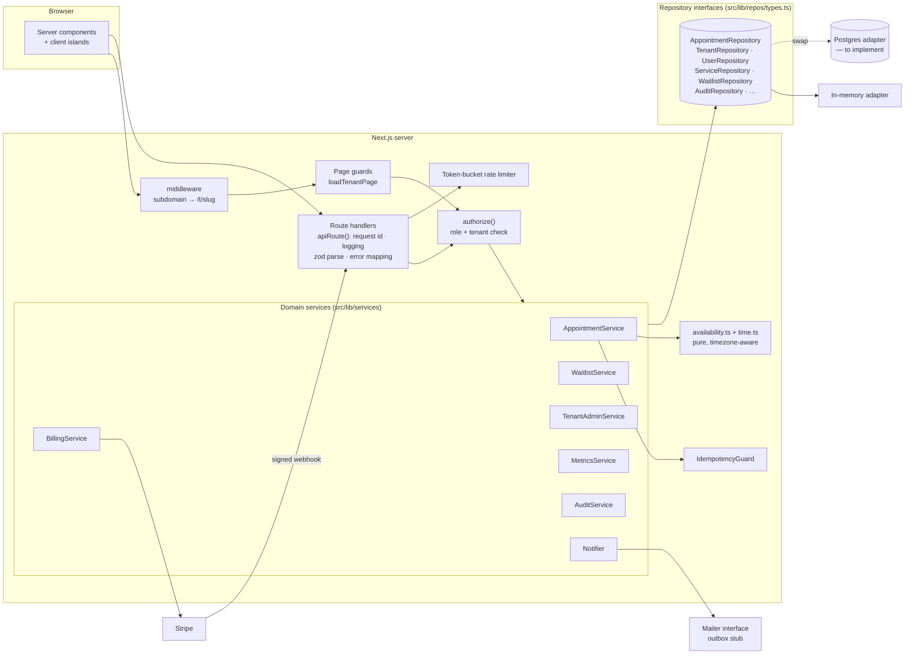

# ClinicBook

Multi-tenant scheduling for clinics, dental practices, physios, gyms and tutors. Each organization gets its own
timezone-aware booking page, a live week calendar for staff, a service catalog, a waitlist that refills
cancellations, role-based access, an audit trail and Stripe subscriptions.

- Next.js 15 (App Router), React 19, TypeScript (strict), Tailwind CSS
- Stripe (subscriptions + signed webhooks), zod (validation and environment contract)
- Vitest test suite, GitHub Actions CI
- Persistence behind repository interfaces (see [Architecture](#architecture))

## Quick start

```bash
cp .env.example .env.local
npm install
npm run dev          # http://localhost:3000
```

Open `/demo` to sign in as a seeded owner, staff member, client or platform admin. Five demo organizations ship with
the app, each in a different IANA timezone:

| Slug | Organization | Timezone | Plan |
|------|--------------|----------|------|
| `riverside-clinic` | Riverside Family Clinic | America/Los_Angeles | Practice |
| `ironpeak-gym` | Iron Peak Athletics | America/New_York | Network |
| `brightpath-tutoring` | BrightPath Tutoring (both seats used: inviting staff hits the seat limit) | America/Chicago | Starter |
| `northgate-dental` | Northgate Dental (GBP pricing) | Europe/London | Practice (trialing) |
| `harbor-physio` | Harbor Physio (cancelled, feeds admin churn metrics) | Australia/Sydney | Starter (was Practice) |

Subdomain routing works too: with `ROOT_DOMAIN=localhost`, `http://riverside.localhost:3000` rewrites to
`/t/riverside-clinic`.

## Scripts

| Command | Purpose |
|---------|---------|
| `npm run dev` | Development server |
| `npm run build` / `npm start` | Production build and server |
| `npm test` | Vitest, single run |
| `npm run test:watch` | Vitest watch mode |
| `npm run typecheck` | `tsc --noEmit` |
| `npm run lint` | ESLint (`next/core-web-vitals`) |
| `npm run verify` | typecheck + tests + build, same as CI |

## Architecture



**Layers**

1. **HTTP boundary** (`src/app/api`, `src/lib/http.ts`): every handler is wrapped in `apiRoute`, which assigns an
   `x-request-id`, resolves the signed-session actor, logs JSON lines, validates input with zod, and converts failures
   into `{ "error": { "code", "message", "details?" } }` with the right status.
2. **Domain services** (`src/lib/services`): all business rules. They take an `Actor` and call `authorize()` before
   touching data, so authorization cannot be skipped by adding a new route.
3. **Ports** (`src/lib/repos/types.ts`): `AppointmentRepository`, `TenantRepository`, `UserRepository`,
   `ServiceRepository`, `CustomerRepository`, `WaitlistRepository`, `AuditRepository`, `IdempotencyRepository`,
   `WebhookEventRepository`. Methods are async and return copies, matching database semantics.
4. **Adapters**: `src/lib/repos/memory.ts` is the only implementation today.
5. **Composition root** (`src/lib/container.ts`): wires services to repositories. Tests create isolated containers
   with a fixed clock; the app uses a `globalThis` singleton.

> **Persistence honesty.** The shipped adapter keeps data in process memory and reseeds on restart; it is correct for a
> single Node process and for demos, and **not** durable or shared across instances. Production needs a database
> adapter (below). The idempotency store, rate limiter and webhook de-duplication are also per-process until moved to
> Postgres/Redis.

### Replacing the in-memory store with Postgres

1. Implement the interfaces in `src/lib/repos/types.ts` (Prisma, Drizzle or Kysely).
2. `AppointmentRepository.insertIfSlotFree` and `moveIfSlotFree` must be atomic. Enforce it in the database:

   ```sql
   CREATE EXTENSION IF NOT EXISTS btree_gist;
   ALTER TABLE appointments ADD CONSTRAINT no_double_booking
     EXCLUDE USING gist (
       provider_id WITH =,
       tstzrange(starts_at, ends_at) WITH &&
     ) WHERE (status <> 'cancelled');
   ```

   Map the `23P01` exclusion violation to `false` / `null`; the service turns that into `SLOT_TAKEN`.
3. Back `IdempotencyRepository` with a table keyed by `(tenant_id, key)` and a TTL job, and `WebhookEventRepository` with a
   unique index on the Stripe event id.
4. Pass your repositories into `createContainer({ repos })` in `src/lib/container.ts`.

## Multi-tenant model

- **Tenant** = one organization/location. Every row (`Provider`, `Service`, `Customer`, `Appointment`,
  `WaitlistEntry`, `AuditEntry`) carries `tenantId`.
- **Resolution**: `/t/{slug}` path, or `{subdomain}.{ROOT_DOMAIN}` via `src/middleware.ts` (reserved: `www`, `app`, `api`).
- **Isolation is enforced in the service layer, not by the URL.** `authorize(actor, permission, tenantId)` raises
  `TENANT_MISMATCH` when the actor's tenant differs (platform admins excepted). Services also verify that the provider,
  service and customer referenced in a request belong to the same tenant as the request, which blocks cross-tenant IDs
  (IDOR). Looking up an appointment by id re-checks tenant ownership against the stored row.
- **Time**: each tenant has an IANA `timezone` and weekly `businessHours`. Slots are generated by walking local dates
  and converting wall-clock times to instants with `Intl` (`src/lib/time.ts`), so DST transitions are correct and
  skipped local times (spring-forward gap) are never offered. Providers have weekly availability windows that are
  intersected with business hours.
- **Plans** (`src/lib/plans.ts`): staff seats, monthly booking cap, waitlist access and audit retention are enforced
  server-side (`SEAT_LIMIT`, `PLAN_LIMIT`).

### Roles

| Permission | client | staff | owner | platform admin |
|---|:--:|:--:|:--:|:--:|
| Book / cancel / reschedule own appointments | ✓ | ✓ | ✓ | ✓ |
| View all appointments, confirm, complete, no-show | | ✓ | ✓ | ✓ |
| Customers, waitlist, activity log, team list | | ✓ | ✓ | ✓ |
| Services, settings, staff invites, billing | | | ✓ | ✓ |
| Platform metrics (`/admin`) | | | | ✓ |

The matrix lives in `src/lib/auth/rbac.ts`. Sessions are HMAC-signed cookies (`SESSION_SECRET`); `/demo` sign-in is gated by
`DEMO_AUTH_ENABLED` and is off by default in production.

## API

All errors share one shape, with codes `SLOT_TAKEN` (409), `OUTSIDE_HOURS` (422), `TENANT_MISMATCH` (403),
`SEAT_LIMIT` (402), `PLAN_LIMIT` (402), `UNAUTHORIZED` (401), `FORBIDDEN` (403), `NOT_FOUND` (404),
`VALIDATION_FAILED` (400), `INVALID_STATE` (409), `POLICY_VIOLATION` (422), `CONFLICT` (409), `RATE_LIMITED` (429, with
`Retry-After`), `IDEMPOTENCY_MISMATCH` (422), `WEBHOOK_SIGNATURE` (400) and `INTERNAL` (500).

```json
{ "error": { "code": "SLOT_TAKEN", "message": "That time was just booked. Choose another slot.", "details": { "waitlistAvailable": true } } }
```

| Route | Notes |
|-------|-------|
| `GET /api/health` | Liveness + dependency checks (503 when degraded) |
| `GET /api/slots` | `tenantId, providerId, serviceId, from?, days?`, in the tenant timezone |
| `GET/POST /api/appointments` | POST accepts `Idempotency-Key`; rate limited per IP + tenant |
| `GET/PATCH /api/appointments/{id}` | PATCH `{action: confirm \| complete \| no_show \| cancel \| reschedule}` |
| `GET /api/appointments/{id}/ics` | Calendar file |
| `GET/POST /api/waitlist`, `DELETE /api/waitlist/{id}` | Paid plans |
| `GET/POST /api/customers` | Staff+ |
| `GET/POST /api/services`, `PATCH /api/services/{id}` | Owner writes |
| `POST /api/staff` | Owner; enforces seat limit |
| `PATCH /api/tenants/{id}/settings` | Owner: hours, timezone, policy |
| `GET /api/audit` | Staff+ |
| `POST /api/billing/checkout` | Owner; rate limited |
| `POST /api/webhooks/stripe` | Signature verified |

### Idempotency

`POST /api/appointments` honors `Idempotency-Key` (8–128 chars). The first request executes; retries with the same key and payload return
the stored response with `Idempotent-Replayed: true`; the same key with a different payload returns `IDEMPOTENCY_MISMATCH`;
concurrent duplicates are coalesced. Keys are scoped by tenant and expire after 24 hours. Only successes are stored, so a
request that failed (for example `SLOT_TAKEN`) can be retried with the same key. The booking UI sends one key per
distinct payload.

### Logging

`src/lib/logging.ts` writes JSON lines (`ts, level, msg, requestId, route, method, actorId, tenantId, …`). Set `LOG_LEVEL`
(`debug|info|warn|error|silent`). Pass `x-request-id` in to correlate with an upstream proxy; it is echoed on every response.

## Stripe setup

1. **Mock mode (default).** `STRIPE_SECRET_KEY=sk_test_mock` swaps in an in-process gateway. Checkout completes immediately
   and upgrades the tenant, so the full flow works offline.
2. **Real test mode.**
   - Create two recurring prices (Practice $49/mo, Network $199/mo) and set `STRIPE_PRICE_PRO` / `STRIPE_PRICE_ENTERPRISE`.
   - Set `STRIPE_SECRET_KEY=sk_test_…`.
   - Forward events locally: `stripe listen --forward-to localhost:3000/api/webhooks/stripe` and copy the printed
     `whsec_…` into `STRIPE_WEBHOOK_SECRET`.
   - Events handled: `checkout.session.completed`, `customer.subscription.updated`, `customer.subscription.deleted`,
     `invoice.payment_failed`. Duplicates are ignored by event id.
3. **Webhook verification.** When `STRIPE_WEBHOOK_SECRET` is set, signatures are verified with `stripe.webhooks.constructEvent`
   in every mode; missing or invalid signatures are rejected with `400 WEBHOOK_SIGNATURE`. With no secret, unsigned payloads
   are accepted only in mock mode; live keys without a secret are rejected, and production boot fails validation.

   ```bash
   # signed delivery against mock mode
   export STRIPE_WEBHOOK_SECRET=whsec_local
   PAYLOAD='{"id":"evt_1","type":"customer.subscription.deleted","data":{"object":{"id":"sub_1","metadata":{"tenantId":"ten_riverside"}}}}'
   SIG=$(node -e 'const S=require("stripe");console.log(S.webhooks.generateTestHeaderString({payload:process.argv[1],secret:process.env.STRIPE_WEBHOOK_SECRET}))' "$PAYLOAD")
   curl -X POST localhost:3000/api/webhooks/stripe -H "Stripe-Signature: $SIG" -d "$PAYLOAD"
   ```

## Testing

```bash
npm test            # 50+ tests, ~1s
npm run typecheck
```

Covered: timezone and DST conversion, slot generation, double-booking and concurrent-booking races, outside-hours
rejection, cross-tenant access, idempotent replay / mismatch / concurrency / per-tenant scoping, plan gating (booking cap,
waitlist), seat limits, RBAC and cancellation policy, audit entries, waitlist offers, webhook signatures and
de-duplication, churn recording, platform metrics, rate limiting, calendar layout, ICS output, email escaping, env
validation and structured logs. Tests build isolated containers with a fixed clock (`tests/helpers.ts`).

CI (`.github/workflows/ci.yml`) runs lint, typecheck, tests and a production build on Node 20 and 22.

## Configuration

Validated with zod at boot (`src/instrumentation.ts` → `src/lib/env.ts`); the server refuses to start with an invalid
production configuration. See `.env.example`.

| Variable | Notes |
|----------|-------|
| `NEXT_PUBLIC_APP_URL` | Base URL used in emails and Stripe redirects |
| `ROOT_DOMAIN` | Apex for `{tenant}.{ROOT_DOMAIN}` routing |
| `SESSION_SECRET` | ≥ 32 chars, required in production |
| `DEMO_AUTH_ENABLED` | Role switcher at `/demo`; defaults to off in production |
| `STRIPE_SECRET_KEY`, `STRIPE_WEBHOOK_SECRET`, `STRIPE_PRICE_PRO`, `STRIPE_PRICE_ENTERPRISE` | See Stripe setup |
| `EMAIL_FROM` | Sender for transactional email |
| `LOG_LEVEL` | `debug \| info \| warn \| error \| silent` |

## Deployment notes

- **Runs as a single Node process today.** The in-memory repositories, rate limiter, idempotency store and webhook
  de-duplication are per-process. Before scaling horizontally, implement the Postgres adapter and move the limiter and
  idempotency keys to shared storage (Redis or Postgres).
- Set `NODE_ENV=production`, a strong `SESSION_SECRET`, and `DEMO_AUTH_ENABLED=false`. Replace the demo sign-in with a real identity
  provider (Auth.js, Clerk, WorkOS) that produces an `Actor`; nothing else in the service layer changes.
- Point your Stripe dashboard webhook at `/api/webhooks/stripe` with the signing secret and the four events above.
- Terminate TLS in front of the app and forward `X-Forwarded-For` (used for rate-limit keys) and `X-Request-Id`.
- Wildcard DNS (`*.yourdomain.com`) plus `ROOT_DOMAIN` enables tenant subdomains.
- Email is a stub: `src/lib/email/mailer.ts` records messages to an in-memory outbox and logs a JSON line. Implement `Mailer` for
  Resend, Postmark or SES. HTML is built by the escaped templates in `src/lib/email/templates.ts`.
- Liveness/readiness: `GET /api/health`.

## Project layout

```
src/
  app/                 App Router pages and API route handlers
  components/          ui/, layout/, calendar/, booking/, tenant/, admin-facing views
  lib/
    auth/              rbac.ts (permission matrix), session.ts, page-guard.ts
    repos/             types.ts (ports), memory.ts (adapter)
    services/          appointments, waitlist, tenant-admin, billing, metrics, audit, notifier
    email/             templates.ts, mailer.ts
    stripe/            gateway + webhook verification
    availability.ts    pure slot generation
    time.ts            IANA timezone helpers
    errors.ts · env.ts · logging.ts · rate-limit.ts · idempotency.ts · ics.ts · seed.ts
tests/                 Vitest suites
.github/workflows/     CI
```
